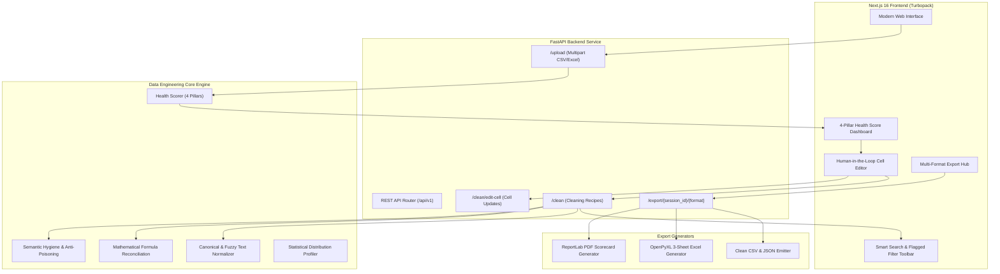

# 🏛️ ZenData Architecture & Technical Specification

ZenData is an enterprise-grade, full-stack data cleaning, quality auditing, and semantic hygiene platform designed for non-technical analysts, data engineers, and business operators.

---

## 1. High-Level System Architecture

---

## 2. The 4-Pillar Data Health Scoring Engine

Every uploaded tabular dataset is evaluated across four mathematical dimensions yielding a composite **0–100% Quality Score** and corresponding letter grade (A–F):

$$\text{Health Score} = 0.35 \times \text{Completeness} + 0.25 \times \text{Uniqueness} + 0.20 \times \text{Validity} + 0.20 \times \text{Consistency}$$

### Pillar Breakdown

| Pillar | Weight | Metric / Verification Method |
|---|---|---|
| **Completeness** | **35%** | $\text{Score} = 100 \times \left(1 - \frac{\text{Missing Cells}}{\text{Total Cells}}\right)$. Evaluates missing null entries per column and flags column missingness $>25\%$ as Critical. |
| **Uniqueness** | **25%** | $\text{Score} = 100 \times \left(1 - \frac{\text{Duplicate Rows}}{\text{Total Rows}}\right)$. Detects exact row duplication and transaction ID collisions with timestamp drift. |
| **Validity** | **20%** | Detects sentinel placeholder strings (`?`, `not given`, `none`, `0000000000`), mixed date formats, unsanitized whitespace, and negative values in financial columns. |
| **Consistency** | **20%** | Evaluates statistical distribution using **1.5× Interquartile Range (IQR)**: $\text{Lower} = Q_1 - 1.5 \times \text{IQR}$, $\text{Upper} = Q_3 + 1.5 \times \text{IQR}$. Detects extreme numeric anomalies. |

---

## 3. Semantic Hygiene & Anti-Poisoning Architecture

Unlike naive automated cleaning scripts that blindly impute missing values with mean, median, or mode, ZenData enforces strict **Anti-Poisoning Guarantees**:

1. **Zero Blind PII Imputation:**
   - Personally Identifiable Information (PII) such as Customer Names, Phone Numbers, and Email Addresses are never populated with mode values.
   - Sentinel dummy values like `0000000000` or `not given` are purged to genuine null values.
2. **Canonical Categorical Taxonomy:**
   - Variations and typos are clustered canonically:
     - `diary` / `Diary` $\rightarrow$ `Dairy`
     - `bakary` / `Bakery` $\rightarrow$ `Bakery`
     - `colombo 07` / `Colombo-07` / `colombo7` $\rightarrow$ `Colombo 07`
   - Known industry acronyms (`QR`, `POS`, `LKR`, `VISA`, `VAT`) are strictly preserved.
3. **Temporal Standardization:**
   - Mixed date formats (e.g., `YYYY-MM-DD`, `DD/MM/YYYY`, `MM-DD-YYYY`) are normalized to standard **ISO 8601 (`YYYY-MM-DD`)**.
   - Timestamps are unified to 24-hour clock (`HH:MM:SS`).
   - Ambiguous relative dates like `yesterday` are flagged with a `needs_review` audit signal.

---

## 4. Mathematical Formula Reconciliation

ZenData cross-validates and reconstructs corrupted financial records using cross-field formula reconciliation:

$$\text{Expected Total} = \text{Quantity} \times \text{Unit Price} \times (1 - \text{Discount})$$

- **Outlier Quantity Recovery:** When quantity is populated with placeholder typos (e.g. `999`), the true unit count is reverse-calculated from Total and Unit Price:
  $$\text{True Qty} = \text{round}\left(\frac{\text{Total}}{\text{Unit Price} \times (1 - \text{Discount})}\right)$$
- **Negative Price Correction:** Inverted or negative unit prices are corrected using the positive cart total.
- **Corrupted Total Reconstruction:** Totals corrupted with string symbols or mathematical discrepancies exceeding $\pm 5.0$ are recomputed automatically.

---

## 5. Human-in-the-Loop Review & Compliance Audit

To ensure corporate compliance and user trust:
1. Every cleaned record appends two transparent audit columns:
   - `needs_review` (Boolean): `True` if any rule encountered ambiguous values.
   - `review_reasons` (String): Semicolon-delimited explanation of all transformations applied.
2. The user can granularly toggle individual cleaning rules on/off prior to execution (Selective Fix Approval).
3. The interactive Next.js table editor supports double-click inline cell edits with immediate real-time health score recalculation.
